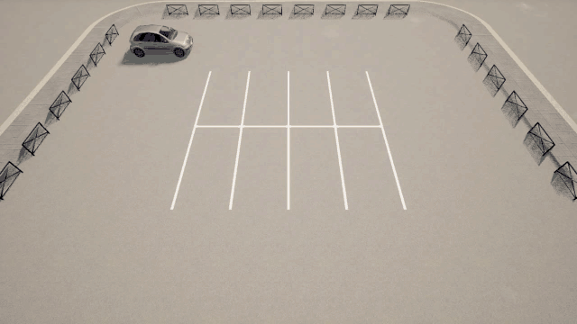
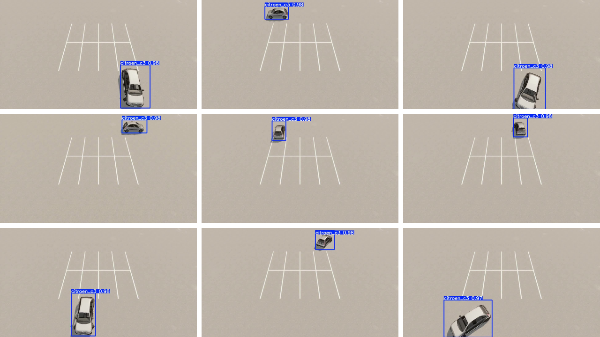
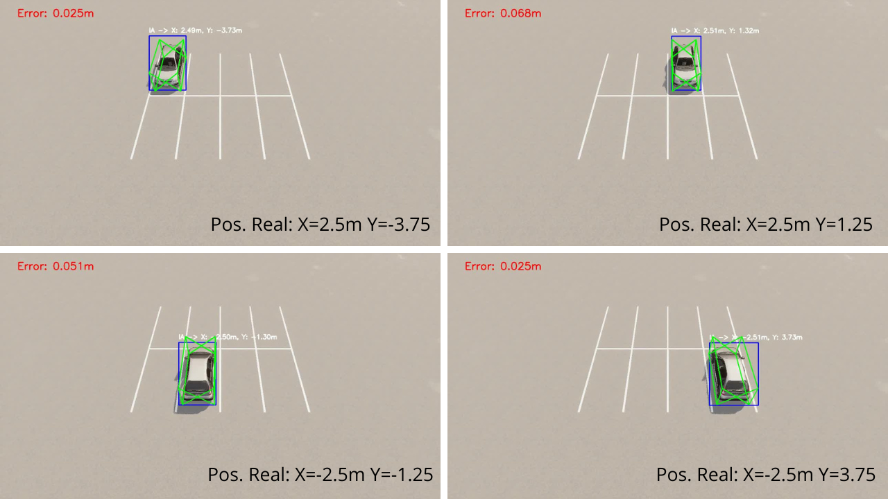

# Vision-Based Autonomous Parking in CARLA

A Citroën C3 parks itself in a 90° perpendicular parking lot simulated in **CARLA 0.9.16 / Unreal Engine 4**, using **only vision** to know where the car is. A fixed camera watches the lot. A **YOLO** model trained on auto-labelled synthetic data detects the car. A **homography** maps pixels to meters on the ground, and a **3D box** of the car is fitted to the detection. The resulting position decides when to drive forward, steer, reverse and brake.



## 🎥 Video

[](https://youtu.be/B9kmm9s6FiY)

▶️ **Full presentation:** https://youtu.be/B9kmm9s6FiY

---

## Results

| | |
|---|---|
| Maneuvers tested | **16**: 8 parking slots, approached from the left and from the right |
| Detector | Single-class YOLO (`citroen_c3`), typical confidence **0.97–0.98** |
| Pixel → meter calibration | Homography fitted on **35 ground control points** |
| Position error | **2–5 %** compared with CARLA ground truth |
| Simulation | Synchronous mode at 20 FPS (Δt = 0.05 s), 1280×720 camera |

<p align="center">
  
  
</p>

## How it works

```
Fixed CARLA camera ──► YOLO (best.pt) ──► 2D box
 (x=-11, z=11 m,                            │
  pitch -52°)                               ▼
                       Homography H ──► initial (X, Y) estimate in meters
                                            │
                                            ▼
             3D car box (4.0 × 1.8 × 1.5 m) fitted to the 2D box
             with Newton iterations (finite-difference Jacobian)
                                            │
                                            ▼
                    EMA filter (α = 0.7) ──► smoothed position
                                            │
                                            ▼
        State machine: drive forward ─► steer + reverse ─► straight reverse ─► brake
```

1. **Detection.** YOLO returns the car's 2D box. The bottom edge is raised by 5 % of the box height so the target is the wheels, not the shadow.
2. **Pixel → meters.** The bottom-center of the box goes through the homography `H` (fitted on 35 points) to give a first ground-plane estimate.
3. **3D box.** The 8 corners of a C3-sized prism are projected with the intrinsic matrix `K` (90° FOV). The center `(X, Y)` is corrected iteratively until the horizontal center and the bottom of the projected box match YOLO's:

   $$\begin{bmatrix}X\\Y\end{bmatrix}_{k+1} = \begin{bmatrix}X\\Y\end{bmatrix}_k + \alpha\,J^{-1}\begin{bmatrix}e_x\\e_y\end{bmatrix},\qquad J=\begin{bmatrix}\partial c_x/\partial X & \partial c_x/\partial Y\\ \partial y_b/\partial X & \partial y_b/\partial Y\end{bmatrix}$$

4. **Smoothing.** `pos = 0.7·pos_measured + 0.3·pos_previous`.
5. **Control.** The maneuver follows the technique a human driver uses. Drive past the slot (≈3.2 m), steer fully (`steer = ±1`) in reverse until the car is parallel to the slot, then reverse straight to the slot center. Every stop decision uses the vision-estimated position, not CARLA's ground truth.

**Known limitation:** YOLO boxes are axis-aligned, so the car's yaw is still read from CARLA. An oriented-box model (YOLO-OBB) or a dedicated yaw regressor would remove that dependency.

## Repository layout

```
├── parking/            Parking maneuvers
│   ├── cases_parking.py            first version, driven by CARLA ground truth
│   ├── cases_parking_yolo.py       first YOLO-driven version
│   ├── cases_parking_yolo_v2.py    variant using best_v2.pt
│   └── cases_parking_yolo_v3.py    ★ final version (YOLO + homography + 3D box + EMA)
├── calibration/        Homography computation and validation (point capture, error videos, .xlsx tables)
├── dataset/            Automatic labelled dataset generation in CARLA, train/val split, YOLO video test
├── simulation/         Early scripts: camera placement, spawning, frame capture, OpenDRIVE map
├── models/             best.pt (final model) and best_v2.pt
├── carla_assets/       Custom parking maps (.umap), DefaultEngine.ini and the compiled CARLA wheel
└── docs/images/        Figures and the demo GIF
```

## Installation

Requirements: Windows, **Python 3.8** and a **CARLA 0.9.16** server with the parking map loaded.

```powershell
python -m venv venv
venv\Scripts\activate
pip install -r requirements.txt
pip install carla_assets\wheel\carla-0.9.16-cp38-cp38-win_amd64.whl
```

If CARLA is not installed in `C:\carla`, set its location:

```powershell
$env:CARLA_ROOT = "D:\path\to\carla"
```

### Parking map

The maps built for this project are in `carla_assets/maps/`. To use them in a fresh CARLA build:

- `Parking.umap`, `OpenDriveMap.umap` and `image.uasset` → `Unreal/CarlaUE4/Content/Carla/Maps/`
- `Parking_Dataset.umap`, `Parking_Capture.uasset` and `Parking_Capture_2.uasset` → `Unreal/CarlaUE4/Content/`
- `carla_assets/config/DefaultEngine.ini` is the engine configuration used (default map, etc.).

The layout also exists as OpenDRIVE in `simulation/parking_20m.xodr`. It has 5 m × 2.5 m slots with 10 cm lines and 4 slots per side, following European parking design guidelines.

## Usage

With the CARLA server running on `localhost:2000`:

```powershell
# Full vision-guided parking run (16 maneuvers), records parking_maneuver_yolo.mp4
python parking/cases_parking_yolo_v3.py

# Homography validation, records parking_evaluation.mp4
python calibration/result_calib_final.py

# Generate an auto-labelled dataset from CARLA, then split it 80 % train / 20 % val
python dataset/generate_dataset_parking_final.py
python dataset/split_dataset.py
```

Videos are written to the directory the script is run from.

## Data and models

- **Models:** `models/best.pt` (used by the final version) and `models/best_v2.pt`. Both are single-class YOLO detectors trained on Google Colab.
- **Datasets** are not included because of their size (~2 GB). Labels are generated automatically by projecting CARLA's 3D bounding box onto the image with `K·[R|t]` and clipping to 1280×720.
  - `dataset_parking_c3`: 3,580 images
  - `dataset_parking_final`: 2,318 images, split into 1,854 train / 464 val
  - `dataset_final_yolo`: 1,414 train / 354 val

## Author

**Jair Vasquez**, ENSTA Paris, PIE project 2025-2026.

The PIE team members also appear in the [project video](https://youtu.be/B9kmm9s6FiY).

## Acknowledgements

[CARLA Simulator](https://carla.org/) · [Ultralytics YOLO](https://github.com/ultralytics/ultralytics) · [OpenCV](https://opencv.org/)

## License

[MIT](LICENSE)
